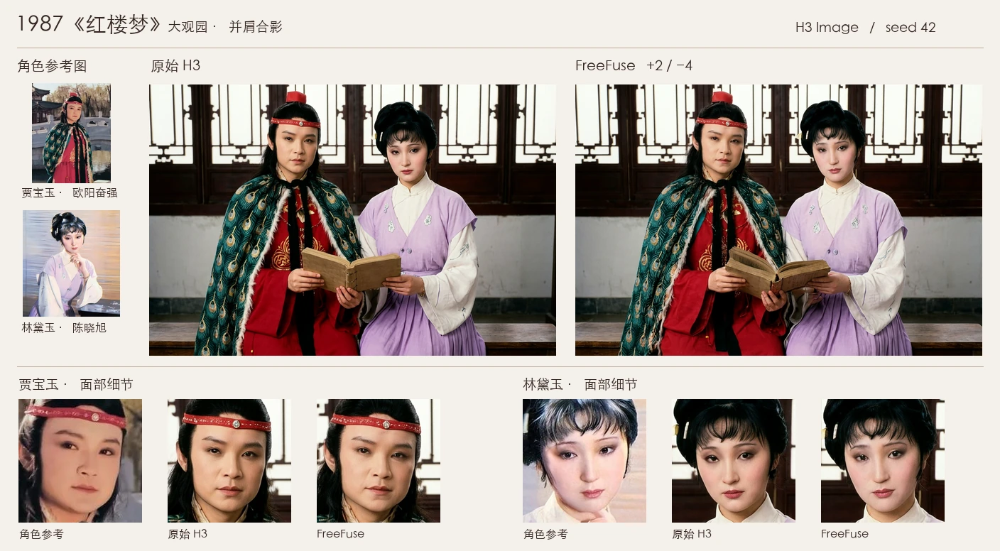

# BetterRef

BetterRef is a standalone ComfyUI custom node pack built from [FreeFuse](https://github.com/yaoliliu/FreeFuse) for native **MiniMax H3 Image**. Each character gets its own reference image and role mask—no per-character training, and no face embedding fed into generation.



*TV still references, H3 baseline, BetterRef enhanced output (`FreeFuse` in the figure is the original experiment label), and face crops.*

## One-Minute Quick Start

1. **Install the node pack** through ComfyUI Manager by searching **BetterRef** (registry ID `betterref`), or clone the repository inside `ComfyUI/custom_nodes`:
   ```bash
   cd ComfyUI/custom_nodes
   git clone https://github.com/yaoliliu/ComfyUI-BetterRef.git
   ```
2. **Place the model files** (provided separately) under your ComfyUI models directory:
   - `ComfyUI/models/diffusion_models/minimax_h3_image_pruned_bf16.safetensors`
   - `ComfyUI/models/text_encoders/qwen3vl_32b_minimax_h3_bf16.safetensors`
   - `ComfyUI/models/vae/minimax_h3_image_vae_fp16.safetensors`
3. **Restart ComfyUI**, then drag [`workflows/betterref-h3.json`](workflows/betterref-h3.json) onto the canvas.

BetterRef requires native MiniMax H3 Image support in ComfyUI (tested at commit `e19f5e957964737da3e80fc54cd21f190a9c7ef3`). Example references and the readout weights are already included; to swap in your own cast, feed a photo from `Load Image` into each Role node.

## How It Works

During the first three sampling steps, a bundled small learned attention readout inspects blocks `10`, `20`, `30`, and `40` to separate each character's foreground from the scene. By default, BetterRef adds `+2` to same-role reference foreground attention logits and subtracts `4` from other-role reference foreground logits, keeping identities separated without touching face embeddings.

## Role phrases and mask editing

- **Chaining multiple characters:** Connect the previous role's output into the next role's `previous` input to add more characters. Keep every role name unique.
- **Role phrases & background:** `target_phrase` must appear verbatim in your scene prompt, and `background_phrase` must also appear in the prompt whenever roles are bound. `reference_phrase` is optional and inherits the target phrase if left blank—useful when a character's outfit changes between the reference and the scene, for example target `"身穿绛红长袍的贾宝玉"` versus reference `"戴红色抹额、披孔雀纹斗篷的贾宝玉"`.
- **Independent reference and target masks:** Both reference and target generate automatic masks that you can refine independently. Click the direct bilingual **Edit reference mask** or **Edit target mask** button to open the editor, inspect previews, and save and run your changes.


- **Same-seed compare switch:** Toggle the compare switch to generate a matching baseline alongside the enhanced result. Disabling it skips the full baseline pass; when no baseline is present, target mask editing works directly on a blank layout.


## Jia Baoyu and Lin Daiyu, seed 42

Single-scene, fixed same-seed comparison at `1536×1024` (seed `42`) using 1987 *Dream of the Red Chamber* TV stills, reported as cosine similarities to the supplied references:

| Character | Metric | H3 Baseline | BetterRef |
| --- | --- | --- | --- |
| Jia Baoyu | ArcFace | 0.552 | 0.646 |
| Jia Baoyu | LVFace-T | 0.404 | 0.554 |
| Lin Daiyu | ArcFace | 0.531 | 0.709 |
| Lin Daiyu | LVFace-T | 0.507 | 0.642 |

## Credits & License

- Built from [FreeFuse](https://github.com/yaoliliu/FreeFuse)
- Example reference credits: [`workflows/h3_ref_examples/CREDITS.md`](workflows/h3_ref_examples/CREDITS.md)
- Repository: [github.com/yaoliliu/ComfyUI-BetterRef](https://github.com/yaoliliu/ComfyUI-BetterRef) · ComfyUI Registry: [registry.comfy.org/nodes/betterref](https://registry.comfy.org/nodes/betterref)
- License: **Apache-2.0**
