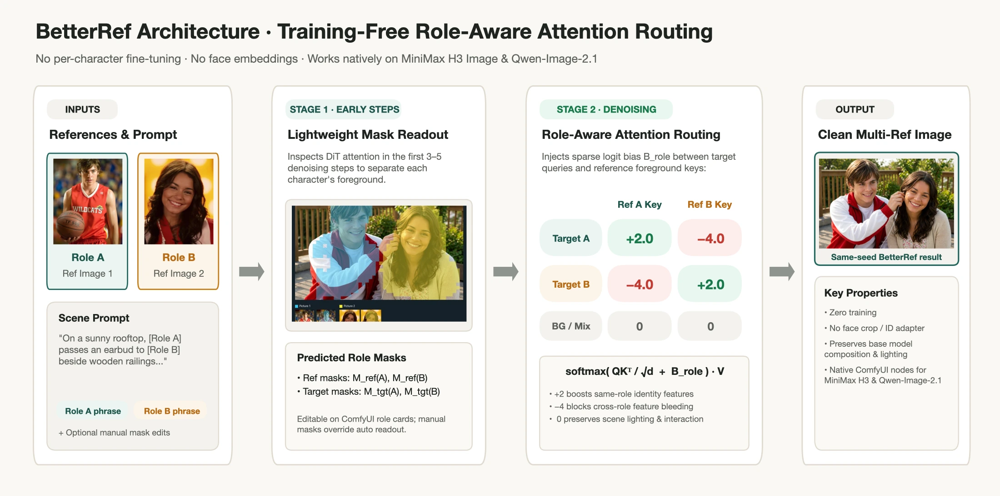
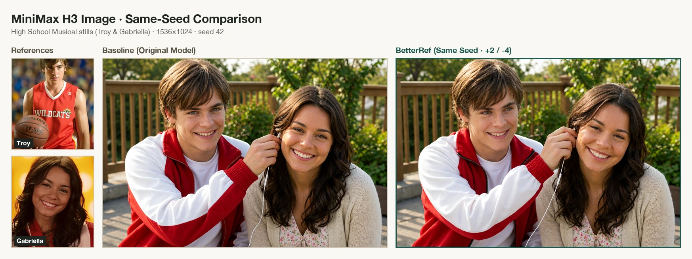
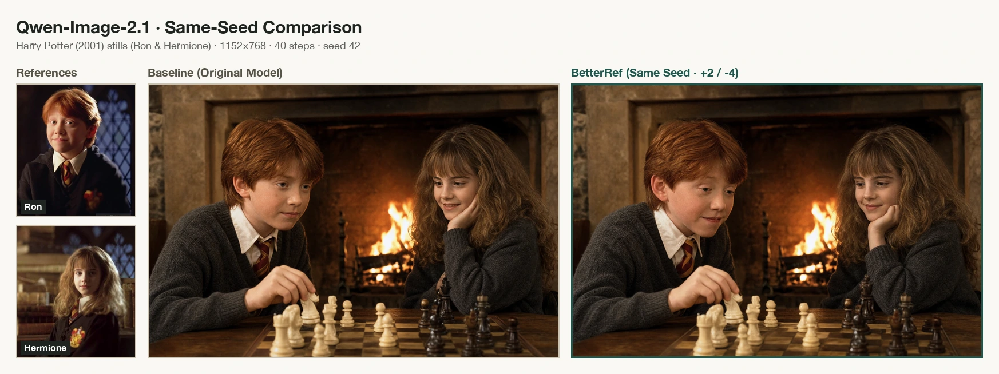

# BetterRef

**Training-free multi-character reference enhancement for MiniMax H3 Image and Qwen-Image-2.1 in ComfyUI.**

Built from [FreeFuse](https://github.com/yaoliliu/FreeFuse), BetterRef improves multi-character identity consistency without per-character fine-tuning, face crops, or external ID adapters. In the first few denoising steps, a lightweight attention readout separates each character's reference foreground and target region; for the remaining steps, BetterRef injects sparse role-aware attention biases (`+2` same-role boost, `-4` cross-role suppression, `0` on background/overlap) so each character attends cleanly to its own reference while preserving the base model's natural lighting, composition, and interaction. Both reference and target masks remain directly editable on the ComfyUI canvas.



## Showcase

### MiniMax H3 Image (`1536×1024`, same seed `42`)



### Qwen-Image-2.1 (`1152×768`, 40 steps, same seed `42`)



## Quick Start

1. **Install** via ComfyUI Manager (search **BetterRef**, registry ID `betterref`), or clone into `ComfyUI/custom_nodes`:
   ```bash
   cd ComfyUI/custom_nodes
   git clone --branch v0.2.1 https://github.com/yaoliliu/BetterRef.git
   ```
   *(For Qwen-Image-2.1, also install worker deps: `python -m pip install -r BetterRef/qwen21/requirements.txt`; set `BETTERREF_QWEN_PYTHON` if using a separate Python 3.12 env.)*

2. **Place model weights** under `ComfyUI/models/`:
   - **MiniMax H3 Image**: `diffusion_models/minimax_h3_image_pruned_bf16.safetensors`, `text_encoders/qwen3vl_32b_minimax_h3_bf16.safetensors`, `vae/minimax_h3_image_vae_fp16.safetensors`
   - **Qwen-Image-2.1**: full Diffusers directory at `diffusers/Qwen-Image-2.1/`

3. **Run**: Restart ComfyUI and drag [`workflows/betterref-h3.json`](workflows/betterref-h3.json) or [`workflows/betterref-qwen21.json`](workflows/betterref-qwen21.json) onto the canvas. Swap in your own reference portraits via `Load Image`, keep each role's `target_phrase` verbatim in the scene prompt, and optionally refine masks directly on each role card.

## License & Credits

Built from [FreeFuse](https://github.com/yaoliliu/FreeFuse) · ComfyUI Registry: [betterref](https://registry.comfy.org/nodes/betterref) · License: **Apache-2.0**
