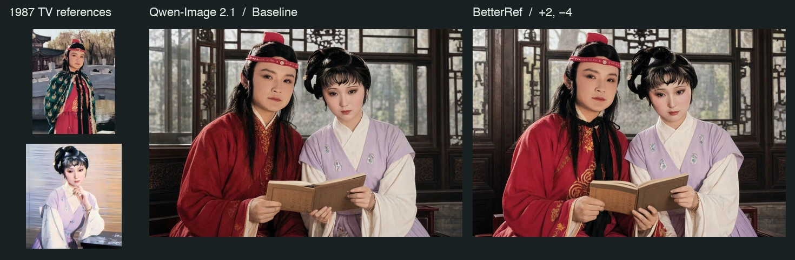
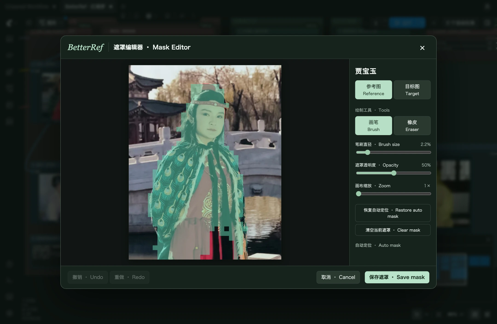
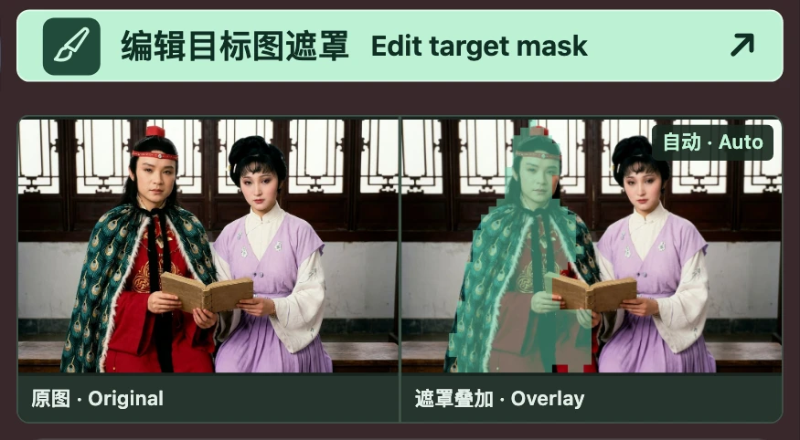

# BetterRef

BetterRef is a standalone ComfyUI custom node pack built from [FreeFuse](https://github.com/yaoliliu/FreeFuse) for multi-character reference generation. Each character uses its own reference image and role mask with no per-character training and no face embeddings fed into generation.

This `experimental/qwen-image-2.1` branch adds **Qwen-Image-2.1** support via [`workflows/betterref-qwen21.json`](workflows/betterref-qwen21.json) alongside native **MiniMax H3 Image** ([`workflows/betterref-h3.json`](workflows/betterref-h3.json)). ComfyUI Manager's published `0.1.0` release and the `main` branch currently ship MiniMax H3 only.

## Qwen-Image-2.1 (Experimental Branch)



*Two reference cards from the 1987 Dream of the Red Chamber TV cast, same-seed baseline, and BetterRef Qwen-Image-2.1 output.*

### Quick Start

1. **Install the `experimental/qwen-image-2.1` branch** inside `ComfyUI/custom_nodes`:
   ```bash
   cd ComfyUI/custom_nodes
   git clone --branch experimental/qwen-image-2.1 https://github.com/yaoliliu/BetterRef.git
   ```
   Or switch an existing clean checkout:
   ```bash
   git fetch origin
   git switch experimental/qwen-image-2.1
   ```
2. **Install the Qwen worker dependencies** from the `BetterRef` repository root using the Python interpreter that will run the worker:
   ```bash
   python -m pip install -r qwen21/requirements.txt
   ```
   The worker uses ComfyUI's Python interpreter by default. To run it in a separate CUDA PyTorch environment (for example Python 3.12), set `BETTERREF_QWEN_PYTHON` to that environment's absolute `python` executable path. Tested with PyTorch 2.8, Transformers 5.20, and the pinned Diffusers version in [`qwen21/requirements.txt`](qwen21/requirements.txt).
3. **Place the model files** under your ComfyUI models directory:
   - [`Qwen/Qwen-Image-2.1`](https://huggingface.co/Qwen/Qwen-Image-2.1): place the full Diffusers directory, including `model_index.json`, at `ComfyUI/models/diffusers/Qwen-Image-2.1/`
   - [`facebook/sam3`](https://huggingface.co/facebook/sam3): place the Transformers files directly at `ComfyUI/models/sam3/` (starting with `ComfyUI/models/sam3/config.json`)
   SAM3 is required only if any reference or target masks are missing.
4. **Restart ComfyUI**, then drag [`workflows/betterref-qwen21.json`](workflows/betterref-qwen21.json) onto the canvas. Default settings use seed `42`, `1152×768`, `40` steps, and CFG `1` with two reference cards from the 1987 TV cast.

### How Qwen-Image-2.1 Works

- **Local Diffusers worker:** Qwen-Image-2.1 runs local-only offline inference in a Diffusers worker with CUDA BF16 and CPU offload. It does not use the H3 readout.
- **Mask generation & editing:** When masks are missing, SAM3 segments full bodies in the reference images and in a same-seed baseline pass. Both reference and target masks are editable, and external masks are supported.
- **Attention control:** Default matching boost is `2` and other-role penalty is `4`. Overlapping target regions keep original attention.
- **Role phrases & ordering:** `target_order` sets left/right target assignment (`same` or `reversed` reference order). Each role's target phrase must appear in the scene prompt, while its optional reference phrase can differ.
- **Compare switch:** Turning off `compare` hides the baseline result. To save the baseline sampling pass, supply both target masks as well.
- **Multi-seed results:** Qwen 3-seed results are recorded in [`experiments/qwen21/README.md`](experiments/qwen21/README.md).

## MiniMax H3 Image


*TV still references, H3 baseline, BetterRef enhanced output (`FreeFuse` in the figure is the original experiment label), and face crops.*

### H3 Quick Start

1. **Install the node pack** through ComfyUI Manager by searching **BetterRef** (registry ID `betterref`), or clone `main` inside `ComfyUI/custom_nodes`:
   ```bash
   cd ComfyUI/custom_nodes
   git clone https://github.com/yaoliliu/BetterRef.git
   ```
2. **Place the H3 model files** (provided separately) under your ComfyUI models directory:
   - `ComfyUI/models/diffusion_models/minimax_h3_image_pruned_bf16.safetensors`
   - `ComfyUI/models/text_encoders/qwen3vl_32b_minimax_h3_bf16.safetensors`
   - `ComfyUI/models/vae/minimax_h3_image_vae_fp16.safetensors`
3. **Restart ComfyUI**, then drag [`workflows/betterref-h3.json`](workflows/betterref-h3.json) onto the canvas.

MiniMax H3 mode requires native MiniMax H3 Image support in ComfyUI (tested at commit `e19f5e957964737da3e80fc54cd21f190a9c7ef3`). Example references and the readout weights are already included. To swap in your own cast, feed a photo from `Load Image` into each Role node.

### How H3 Works

During the first three sampling steps on MiniMax H3, a bundled small learned attention readout inspects blocks `10`, `20`, `30`, and `40` to separate each character's foreground from the scene. By default, BetterRef adds `+2` to same-role reference foreground attention logits and subtracts `4` from other-role reference foreground logits, keeping identities separated without touching face embeddings.

### H3 Role Phrases and Mask Editing

- **Chaining multiple characters:** Connect the previous role's output into the next role's `previous` input to add more characters. Keep every role name unique.
- **Role phrases & background:** `target_phrase` must appear verbatim in your scene prompt, and `background_phrase` must also appear in the prompt whenever roles are bound. `reference_phrase` is optional and inherits the target phrase if left blank, which is useful when a character's outfit changes between the reference and the scene, for example target `"身穿绛红长袍的贾宝玉"` versus reference `"戴红色抹额、披孔雀纹斗篷的贾宝玉"`.
- **Independent reference and target masks:** Both reference and target generate automatic masks that you can refine independently. Click the direct bilingual **Edit reference mask** or **Edit target mask** button to open the editor, inspect previews, and save and run your changes.



- **Same-seed compare switch:** Toggle the compare switch to generate a matching baseline alongside the enhanced result. Disabling it skips the full baseline pass. When no baseline is present, target mask editing works directly on a blank layout.



### H3 Results: Jia Baoyu and Lin Daiyu, seed 42

Single-scene, fixed same-seed comparison on MiniMax H3 at `1536×1024` (seed `42`) using 1987 *Dream of the Red Chamber* TV stills, reported as cosine similarities to the supplied references:

| Character | Metric | H3 Baseline | BetterRef |
| --- | --- | --- | --- |
| Jia Baoyu | ArcFace | 0.552 | 0.646 |
| Jia Baoyu | LVFace-T | 0.404 | 0.554 |
| Lin Daiyu | ArcFace | 0.531 | 0.709 |
| Lin Daiyu | LVFace-T | 0.507 | 0.642 |

## Credits & License

- Built from [FreeFuse](https://github.com/yaoliliu/FreeFuse)
- Example reference credits: [`workflows/h3_ref_examples/CREDITS.md`](workflows/h3_ref_examples/CREDITS.md)
- Repository: [github.com/yaoliliu/BetterRef](https://github.com/yaoliliu/BetterRef) · ComfyUI Registry: [registry.comfy.org/nodes/betterref](https://registry.comfy.org/nodes/betterref)
- License: **Apache-2.0**
